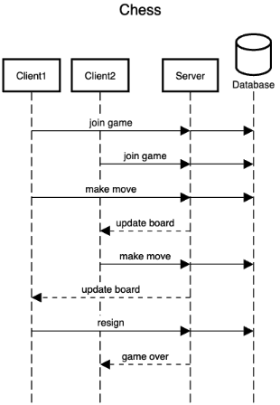

# ♕ BYU CS 240 Chess

This project demonstrates mastery of proper software design, client/server architecture, networking using HTTP and WebSocket, database persistence, unit testing, serialization, and security.

## 10k Architecture Overview

The application implements a multiplayer chess server and a command line chess client.

[](https://sequencediagram.org/index.html#initialData=C4S2BsFMAIGEAtIGckCh0AcCGAnUBjEbAO2DnBElIEZVs8RCSzYKrgAmO3AorU6AGVIOAG4jUAEyzAsAIyxIYAERnzFkdKgrFIuaKlaUa0ALQA+ISPE4AXNABWAexDFoAcywBbTcLEizS1VZBSVbbVc9HGgnADNYiN19QzZSDkCrfztHFzdPH1Q-Gwzg9TDEqJj4iuSjdmoMopF7LywAaxgvJ3FC6wCLaFLQyHCdSriEseSm6NMBurT7AFcMaWAYOSdcSRTjTka+7NaO6C6emZK1YdHI-Qma6N6ss3nU4Gpl1ZkNrZwdhfeByy9hwyBA7mIT2KAyGGhuSWi9wuc0sAI49nyMG6ElQQA)

## Modules

The application has three modules.

- **Client**: The command line program used to play a game of chess over the network.
- **Server**: The command line program that listens for network requests from the client and manages users and games.
- **Shared**: Code that is used by both the client and the server. This includes the rules of chess and tracking the state of a game.

## Starter Code

As you create your chess application you will move through specific phases of development. This starts with implementing the moves of chess and finishes with sending game moves over the network between your client and server. You will start each phase by copying course provided [starter-code](starter-code/) for that phase into the source code of the project. Do not copy a phases' starter code before you are ready to begin work on that phase.

## IntelliJ Support

Open the project directory in IntelliJ in order to develop, run, and debug your code using an IDE.

## Maven Support

You can use the following commands to build, test, package, and run your code.

| Command                    | Description                                     |
| -------------------------- | ----------------------------------------------- |
| `mvn compile`              | Builds the code                                 |
| `mvn package`              | Run the tests and build an Uber jar file        |
| `mvn package -DskipTests`  | Build an Uber jar file                          |
| `mvn install`              | Installs the packages into the local repository |
| `mvn test`                 | Run all the tests                               |
| `mvn -pl shared test`      | Run all the shared tests                        |
| `mvn -pl client exec:java` | Build and run the client `Main`                 |
| `mvn -pl server exec:java` | Build and run the server `Main`                 |

These commands are configured by the `pom.xml` (Project Object Model) files. There is a POM file in the root of the project, and one in each of the modules. The root POM defines any global dependencies and references the module POM files.

## Running the program using Java

Once you have compiled your project into an uber jar, you can execute it with the following command.

```sh
java -jar client/target/client-test-dependencies.jar [port]
```

The optional port defaults to 8080. Start the server separately before signing in.
The client supports `help`, `quit`, `login`, and `register`; registration signs you
in automatically. Use `logout` to return to the signed-out prompt. Password entry
is hidden when running in a terminal with a Java console. Once signed in, `create`
prompts for a game name and creates a game with both seats open. Use `list` to see
current games, numbered from 1, with each player name or an open-seat label.
Use `play` to display a fresh game list, choose its number, and select `white` or
`black`. Use `observe` to choose a game and view it from White's perspective
without taking a seat. Enter `cancel` at either selection prompt to return.

The board shows the initial position with uppercase White pieces and lowercase
Black pieces. Its orientation follows your chosen color. On the board screen,
use `redraw` to display it again or `back` to return to the lobby while keeping
your seat. `help`, `logout`, and `quit` are also available. Expired sessions return
you to the login prompt. Live game updates and moves belong to Phase 6.

## Packaged Phase 5 rehearsal

See the [Phase 5 pass-off guide](docs/phase5-passoff.md) for the latest verification
results, demonstration sequence, and remaining submission steps.

After building both JARs, run the client/server rehearsal with Java 21:

```sh
python3 scripts/verify_packaged_client.py --output /tmp/chess-client-rehearsal
```

Use a new output directory for each run, keep MySQL running, and leave port 8080
free. The local account in `db.properties` must be allowed to create a temporary
database. The script copies the server JAR with a disposable database configuration
and runs the actual client JAR through registration, creation, listing, both player
colors, observation, logout, and login. It also checks invalid input, occupied
seats, server restart persistence, an offline server, and invalid startup arguments.

Client transcripts are saved in the output directory. The temporary server,
database, and copied JAR are cleaned up; development data and configuration are
unchanged. Optional `--client-jar`, `--server-jar`, and `--config` arguments select
other local inputs. This rehearsal supplements unit tests and visual checks; it
does not submit the assignment or replace the TA demonstration. Password hiding
requires a separate interactive terminal check because this script pipes input.

## Phase 4: Persistent database

Install MySQL 8.4 LTS and start it before running the database tests. On macOS
with Homebrew, use `brew services start mysql@8.4`. Create your local configuration:

```sh
cp server/src/main/resources/db.properties.example server/src/main/resources/db.properties
```

Edit `db.properties` for your local MySQL account. This file is ignored by Git;
do not commit database credentials. The example matches a fresh local Homebrew
installation. The account needs privileges on the configured database and its tables; it does
not need access to other databases.

The default server now uses MySQL through `SqlDataAccess`. Startup creates the
configured database and missing tables without replacing existing records. Users,
sessions, player assignments, and full game state persist across server restarts.
The unmodified official `DatabaseTests` and `StandardAPITests` are active.
Use `new Server(new MemoryDataAccess())` only when explicitly testing memory storage.
See [notes.md](notes.md) for the implementation history, the October 31 grading
failure investigation, and the corrected verification evidence.

Run `mvn -B clean verify` with Java 21 against a disposable database.
The SQL tests reset application tables in the database named in `db.properties`;
they do not create arbitrary catalogs. Both these tests and the official API tests
clear configured data. Do not point a test run at a development database you want
to preserve. The build requires at least 80% line coverage in `dataaccess.sql` and
writes its report to `server/target/site/jacoco/index.html`.

For isolated verification without changing local configuration or development data:

```sh
python3 scripts/verify_tests.py --output /tmp/chess-verification
```

Use a new output directory for each run, set `JAVA_HOME` to Java 21, and put Maven
and the MySQL CLI on PATH (or pass `--mysql /path/to/mysql`). The script uses the
local MySQL administrator only to provision and clean up a temporary account with
privileges on one random database. Tests run in a copied checkout under that
restricted account, and an explicit negative check verifies that the account
cannot create another database. Administrator defaults are `root` at
`127.0.0.1:3306`; CLI option files can supply credentials. Logs and reports remain
in the output directory; the temporary checkout, database, and account are removed.

After the October 31 corrections, all 490 tests pass with these restricted
permissions, including the 26 official API/database cases and 84 SQL cases. Using
the public grader's JUnit/JaCoCo tools on `dataaccess` alone also passes all 96 cases
and measures 166/171 SQL lines (97.08%). The public course Checkstyle tool reports
zero errors or warnings across shared, server, and client sources and tests.
These are local checks; the corrected commit has not yet been graded remotely.
The earlier submission at `8d3b4f` earned 69.35%, despite passing functionality.

To reproduce the separate grader-tool check, use the `phases/libs` directory from
[the public autograder](https://github.com/softwareconstruction240/autograder/tree/a1cc752ffb51a8b15400bd4fed8ee2ba978885a9/src/main/resources/phases/libs):

```sh
python3 scripts/verify_tests.py --output /tmp/chess-grader-check \
  --grader-libs /path/to/autograder/src/main/resources/phases/libs \
  --grader-java /path/to/java
```

By default (`--phase 4`), this mode builds the artifact and runs only the grader's `dataaccess` selection,
with its bundled JUnit and JaCoCo. It exits unsuccessfully if tests fail, SQL
coverage is missing, or SQL line coverage is below 80%. The recorded run used Java 26 for those tools
and Java 21 for compilation.

For Phase 5, add `--phase 5` to select the `client` tests and require at least 80%
line coverage on `client.ServerFacade`. This also rejects missing coverage and
an empty test selection. Without `--grader-libs`, the script runs all Maven tests;
`--phase 5` additionally validates and saves facade coverage in `client-jacoco`.
Both modes use a disposable database with restricted permissions. The client Maven
build independently enforces the 80% facade coverage minimum during `verify`.

The quality check is separate:

```sh
/path/to/java -jar /path/to/autograder/src/main/resources/phases/libs/checkstyle-1.0.9.jar \
  -c cs240_checks.xml shared server client
```

To verify the executable server across separate JVM restarts after packaging:

```sh
python3 scripts/verify_packaged_server.py
```

Use Java 21 (`JAVA_HOME` or `java` on PATH), keep MySQL running, and leave port
8080 free. The script copies the packaged JAR into a private temporary directory,
replaces only its database configuration with a unique disposable catalog, then
checks four separate JVM launches. It verifies persistent credentials, sessions,
games, player assignments and generated IDs, as well as durable logout and clear.
It stops its own server and drops only its temporary catalog afterward. The
original JAR, local configuration, and development database are not modified.
Optional `--jar` and `--config` arguments select other local inputs. This older
packaged-restart script requires an account permitted to create its temporary
catalog; use `verify_tests.py` for the database privilege compatibility check.

After running a full Maven suite against a disposable configuration, restore the
normal local configuration and run `mvn -B -DskipTests package` before launching
the development JAR; this puts the restored configuration into the artifact.

## Phase 3: Chess Web API

With Java 21 and Maven available, run these commands from the repository root:

```sh
mvn -B clean verify
java -jar server/target/server-test-dependencies.jar
```

Open <http://localhost:8080/> for the course-provided web API testing page.
Stop the server with Ctrl+C. MySQL retains users, sessions, and games across
restarts. Calling `DELETE /db` removes all application records.

The server implements `POST /user`, `POST /session`, `DELETE /session`,
`DELETE /db`, and `GET`, `POST`, and `PUT /game`. Protected endpoints use the raw
auth token in the `authorization` header. Request/result types are in
`shared/src/main/java/request` and `shared/src/main/java/result`.

`mvn -B clean verify` includes the unchanged supplied `StandardAPITests`, service
and storage tests, and HTTP validation, failure-recovery, and lifecycle tests.
Running these local checks does not submit the project for grading.

## Phase 2: Chess Server Design

[Open the completed design in presentation mode](https://sequencediagram.org/index.html?presentationMode=readOnly#initialData=C4S2BsFMAIGEAtIGcnQMqQE4DcvQCLIgDmAdtALTQCyAhsMIgO7QBKt8AtgFC0DGwAPaY44EJFLBuAB1qZQfELMnosuTDLkKltFQAldAEygbZ8kIuXBVOC5E3nLu6-nq0Agnz7Ik3Q24AjWiQYV2BaIJDubgB6GOgABUxBaUEQw2gQSSx+UEFSVAAzYUT4YJgAZgBuaH9wyJgUnLyC2uQ+TBAAmEYYJCFMWmIYPnzgQYEAOm5iZIBXaWgAYkhaQoAmQsK2SGIQfrwlgPB+AGtuWDEJawoAPht1AC5EgHk0ABVoGLmQzAAdUgAbx+WFItE4kAANNBZCgmMJDNDIJxaCBwABfbgYHB4O7QAykYxYZ6YXb7YBYAlEzAAClG2QAHsAAJTcKkmSj3dnEtq-EC0MQALxgACk0C8AHKZSSCHZ7A6YViQACOc2QUgCpNop2gKPAxUwEIyYsl0BKWVGnFkoGOMEK4nAGWAAE9pMg2UYORQ8dintAACwABkD0EBACIISghpAw48wwBRTDJTDPIIZUmq9VhzG+3F4y7iSTPIMh8ORpDR2MJpPCVO0dMqtX9bPcCSGD2Er33X12ElkhU0pXyimKxvq1ma1Y6jNN6z7aCkObgcBmkQgzBgiHQ2FIeGYRGr6DI1Er+ecfZILLEGKL5dYtR2Sh47kp6CMZIsABC9aVmf68YZbxpBaDtqSfbs1B5EtQwjHxKzjRNkzrBs-2AFtcxEb17gLa5i2DGDy3g6skOgNNoBnLNMTbe9bG8TkCDcTxvBQZ5hmAABVX4aXXTdIFZMIPC8Hx6IEhpnntQloHXUjnSk35eO4UTynAhjwiYnxnk4rABMPW9wEUxihJQFSe28Z5pIAXmgLTMB0ko9O4SdtTkvB51IQRrAc0yYCw-FPR5d9BBYdxwC1QxnXebUJAAoCQJfEzINfIMKgIuDhirRDa2gAUwtk8JTgkdDEpUnCiwDQMUrLNKYwQmtXxy1ZwrfKLSBbajvPo7znh3PdDAMJB4GgKyygGhJgl3BEaR6hFWQ6vEBPUljoA6VYKRsmkbIE7j5PBKEAWm-d+vgJEUTRZl+MM5jUHmwJymefphBgTa3AM+plN8hajKQe6BkgdtPquhLaMgPtgDmDcaOwR8fQfMzsrmRh3kEAryCs4ZSGaSAkZRmlmQBH4r2s9iAEl8EmQZCUETh2JJ-Bcch6H7gBjTlq1Cl3AR+AaQ5xgttoTnsYkaEeN287XsEwGbrekIfse6AefgATxYaFTmaWh7SX+y7hN8rryMgMGIbm59-NfIdySwJUkCXYBttBXboX5xHkYkVl4pNzseT5AUQGFfXrfAawhGgE0JVAr0YZxV91nw4Edq3eHnZRnNit80rgGeGPSxFhOnfgQXSCowlojieXA-t0BcDfLBzzBFozW2c2FUybZdFkupaGyr6zTdQZ68KE8kGmWZBAWZZCgqQp-UKAA2OULZEDXoyPOrlmOM5uHcikzXUB47EhJSZYIcHCbb2pbpCHvmhAfJsoCQRcBqB7Fl6BdhD1aBCnAILpkPnypYlizJewxP4nnBvYNW11I5QzhoFFgkCYqQGAjfUgDM6K+RfN1ZIshiD0FCNrFAiDkH5HDnmCCUdngAFZY6wSjOlWqJEsgjjBCuX4u8sDJiKlHEqVwyrUNLLQis9DiJZSYfbVhxUOHCDasXGY8xFhLC2IUAAjIYbYAAZQQexyBHBOHwc46dOqJWeAkN4nwYghBQCggEcd7YJwOoYFO3CPbUmeN-bRL46RjEgEyN2pt6KYN5FgfkQpRTiilEw2UmjtG-lnI5LUOo9QGiNCHcJh4LRU2tF0KAn8HROldO6d20CoI0MIsIzKr4yIUWbE43eadeEZ3KgIspNURGVPrPrVCMj2zu3ITAkG0B3FZBpNErIsTxzxKnJ02cmRUB6UPDnRoIgHGzN1BeK8N4lz6WNlyU2zw4HQG-IYcZ-5AJILiv43WximmpToa0ipyFpmUUhmQ0QhZGnQSqncjKdVHnVLQkXdsc0mYEO+tANi61FkXTUt3ABYlcmSWkgEWSizlbvQAYtMFz1wi6S2eLTFQN+nmV+ENayvw7IiAck5HU0k3J4p2X5T2r4DnsTBJzYQvs-pEIuUywlJTlG3KEfc35Uk2WMA5cKQwXC6n5gaXhAVXyhU-JInMMV8AJV-W6WgnyfTewwnGr1OgwA+CICQFNA1CJha-EmA4icCT9VwgRLUQQyA37WBRMawar8NZ-WgCNeA2qVKBJZWqjVhhuUoNIZhYpSVAwKsEURB5oq85hula89O8rBWJpFaqlNnRJVauBXvOGecC6kvRpjAuuN8aXlIMQImpNyZGCpjTUm9Mi2QOeCtPBCtuacz5gLF2pArV2L4tCwBxk4V3WgD6hckBgr9rcDUaQpI2GNF6IvHwKDfB-1VqC2Wmt8WwugXq0khtUEMsCaM0gVsbZ2w3A7RO+ch1+N5S4kw91gk+z9qum2b5ZShyjXy6OsdFmO0HcnF50bsJyugFnUMYGn0F0BSXeIIVmH0BAFXEctdMO30EBorRWQW7ZVIO3NwXdAZND7ig0BaIh5yNHgoieU9Z7QGvTOgYy8pEiF0RvLejRd7eQPhfAZ+AT51tI+R6WjRe54fIBEB+kAn5CBfogN+hoBSf2-kwX+om90wquge5eA80TgKPZLE9sD4AflUhOpAEaSGXr2TCbBQw8F2cxY51BRS+k8n4Vm8pIqxEPokdwnjaboNvNwtAALirs2MOyKFmdki6pasY2PFYawADsvromj2sHx-RFwGlGIoQQeM6j4zvHjF8Sxl58gAjzb7eTzxS1DqgwElz7iCuePpBSXxQH308jCk+iV8m-WNSwACSJ7GtEFZObbdrKNX1gSswMnrCMRnzYRotu1UzmuCgm0IFGqzzxWMkyUZEwFnSBowS5kNh2uVnOIT5y5MbM3xaCyq0N+bNW1PTbBoM8aWnKqyrm9lf2pUoY7fu8FBte3LddhZnWIKZPiSyBkQ7E3kVIY67uj6cOFYUoXHiyBhK9V51JcTij9k8XUqfasrysN-67KZfsmzQVrK-c5eGl7PK1sffKiD6qYPXwQ-FVDyLPD3mfYTd98HPOC0w5ZyJOHhhIBQHZpzGkSPSDjoJVOo+pJOBKbNKQcAeV1MepNafSHLWQIE4xV9Z4Gutd-RR5O9boNwaoIEzvPAwm-4mNXZBFymAkDQlwZGR2kkBQrg8ogTdVj8gMec+z-W56hts9cazVaMBrsulSaaVdqQCgwEBJiXzDweTwcr51+psu4OxxQ7END5cH2Vx6DXLIE2CNzeIAVkjkAwBJ-Pji-gVG5P90HsPeR49J7TznvlhGnHhDcdXkV84-ulMiCD6J544nOiSbYgrQ8buDaQDP4px+a+1MwHcpplcX8f5osvoTwzQCuMgNM+Acz5OrlgYOdbMEF+dI109c8V0Uh3Nt5QDYpI1q8MIqFSlRcGFREksWEUtws0sAcosM1YsUDvk0DXwQtMC10RAItW8R5MsWMl9RBVgRBaBpBpAxA+AJst8St3kys-R8BKtqtasYhDAAgG8c8P1looA5A+tvFBteli0Bk+AJDaRZpVdncjNxCGD6YAC0cIhp0Tczd48xt815Md19MP97M+xTdcAtZP9J1tD4U9Cq4DDo93QndtDMULClNrD7M1d0d9ZLCYADD1wTCZMDNzC-DPDPcoFdU4Yz1fc7thtXxYiIZZDAlu1t5C9ZJQ5-Yy9L569EDrk69cCZcYtCjN4PJBM8B04RNfCJRZRsd65EB6w8ASh-lSJBAmp5wZwQBNZJgAR3AFNQpGpnQKAMi19SRspwAkBZRrYhI-oGNqI28y4MMu9q5DRe965+9LgGCSMz4HCtNf8GNqDmNF82Mti5AxiN9kw149Ft9yiA898WdqidCj4j9CYFCNDmQ74lMVMUg3x1NH8P4X9dM39WdPMXcLif8wFSRIiKdrMQDQVvN4jRCeQoCcEPM4DzkED3s-NXw4t5dhVEsMMwt2EcCG9ZUm88TQdiDnhSCtNyCV5OEqD59FFCg-o8tyRoAABxXaVADgwxIXTk6rL4Zwpre3I7FoNrCDCQEQxlXPMQfobkyMKQxkFkbPWUsQ0beo2jRojXf4UgWbdRckRU5ARbXXKU-XNUvWeU4AY0s1Q0hUnkvbSZZyLU2+E7CQM7dZS7Cgq0F0JE9UgKTnFgVlJ7PneAkhfI8rYHQLAkxXUM6XRvGLaMr7WM8XJXf7VsYuWHGwsFU-HXPXA3WFOw6dCSLHMUnHWSPXEE0I9w+WRdHFOnO8AA73RnKyGnBsylene1KnOlO8CAsQx7MU57cMt7N9IXZM-EsXcydM6HMkmDJvCcqktpac+MlXYGHwsI6020zQ0FDc+wg2ToSARw5ccFHk6ssw2s0YZcSAAQWjfvY0nSKaNIS8Y4WSDIwsyzaI+QwQa828-DbYB8l6ItPWFERYVYE1Lk3aHSYOY0tAOYTgFETAZ0AEGkZw0maEJgeAMASAGyXiSEAEdefRXCx9ZwiUUWf0q9I0x05AO9ZwpAVbLsAM18b2UJf2P9YOUOKoGbUgBQuYDXUnE8lg2gZ0PAXiXwSMv0OvMMOi2MAAbUBDQvwAwqwrWnjj2lIEItOGIoTlIt2nRGhEmEMoAF0ijEyyopKZLHh5LFLlLsLtL1LNL7Ko9doyKIR9LoBDLJgTKyjt5d85Cnj4UlRz0JiVw6LoQt5oAAArH4IOdTNg68zAAAclQDot6NIHwFlAitN0MBAEKFkjosPHq23S4vcnPFipgAQB8GNM4w80KGSE4D+JgFL1T0gGmB313iqMCXjF9Nkh9UzhoUstkpMoBFZUEC8AWHEAyBCHoDBUwrsrUsPEcoWt7PAGmAWNLnQwriw27zWLrjvI0Q5NtOH1HzwA7ko2EmowmwOLnyYwX1Y2X0Op5IhIL0300p8oqIeOBgCunVeJPwR05kPC3Kepv2Uzv0ao00BJ0z0xCIvPBOATtChIgV3MAKJT+PhJzMRP7JRLc1wVgIRLAIjOxJr1xMIKVWpOlCJKwJJMZLnOiz4VJoS3QMpvpMoMzPbAy2OL+i2DgDZhgGqr5NKyF1MQ+GFN2lFMlwdxQUlKTgkBsV0rcplNSN5uNOVIG1VJSJc01PLIaKm0YMkg1xYs5WLwlG4uDlgGVt2lNL12cohFcr4mdMSQFGSV9SyPNB4syUw1tFyU13yTdHEqJqQJuRTKnNIg6X+QTPJKTIZoV3aRQlnC1VkL1jSMgGNJpHNvz2NKdIZ1aJWoooeyDMOR-DHFORHKG3HOjtTL+WLoBVpvwM+UnPJqqWrq1QZ1dPIHdPIDPC9PrSux6rzoz0HIlslURIkv5RjJDol3VSl1MsjrKkXNQOXOTSHNnPahULcPBLzMYDNJlotK0Ls3hVLMMMltvlxyrNcLBLUPbM7kbP0mbK-OlsGjbPrOvs7LvFboBtzqxuZQLpDOXpHoDuuXnqIMXsntTRnvnKjpF2AaTVAenrZodtPNtt2k9Iu2vGZ3XPuwHoLqOUW3-rHJxLwmaQXqTSbq6XAbpo+QrpDtIfjrXP6W4L1WcNJQxhYEqpQFTrxgKHCEJDkCmvCHMEk3vl4ZqAAHUVKYB-Cihuj+g7t161Dk7U75aoREH7a97g8xiH951IKIQdImBR9spRUQBMwVHSYUKbKBLwBwqtkbbIA7abHx0VZYa1DxoSAMYMhFKYSUbGHdpSZ+7c9068FM6aLA5UKfH8AGLcRkTmKv1WLf1A5-1jay6CHm9SxFLyH8C680n3r7j-L1GAnQBJNO4mHDAXU5kPIorBBiNX40iShg4R8N0Ut6A0rPxE8YQTgRLKUnr+gtBso5ktkagfFyRCYCqTdURyBVUTVdBhhDA1rZENqO89rsMe89r-yeb89tGYBcqjwTqRAzrJ8Lrp9aNrqOa7q6D8m+bkH4aGSSgOD2rA9Hj1Hfr61N7BoSgFHkGQafj78Ib9iobzzVCv919ISzNoS765DgCucMTXs-GxDUSYD8EMaCbRzBdknKTiHgsMC6TUsaaMJij6aiHoGMXmbsXpEmTbqWTCgABOIQkOSp8gfmt6-k5JhIdicxEUpXVrPHFGGxISjp2AH84QGx0mUyqJ54SKullW02LxFUiJzCUV-WDpNuybJovWjIA2mJo20OU2gDCVy26u7e59FGbcdprAfl7+TAIV8JhBpJd+F2tJN2y0LJL2+0H2t8Apf2-B4mwh8exusO5u9JoHKh31uO55aiROlnMV3ViEGkEUKNyALO+1HOvpvslQhIiFr8Iu1CPBlFr1oOhuxemh55XFsyyhglsmgtv1sh+B9+oe47IdFB2tHun0m7GFwM2zX+oe4czEwmz1wOoB8tmBmciOiBueuNH1kBoduhxmC+lmF5g1guD81HfekszHI+8U2jU+80-5uRlmK+3FJs5GlsqnJ+3mWnV+-SGtwaT+1N+Vweqe3nbNiOZJ-txmtM1c2uwNqBgdnNSd6t+1RShtjZeZEoXl01gVkQNyepsfERvQYmGrDTQ5dRdwWAAAaVbe-tsxwersfdeT7aDYrZDZqQ-YXPw5IcrdofgezLCLYkUbCcXdsOXaPkPqYdxw8fPs7Q2ZJwcjBb1iYaskAo7IsYQaYevYwbTbRq5yw6zaRaSdzfrqXLI8I5ruLdntLfHcU6eSI9XowfvulCQDdAEHBtA86YhE-lqfU3+V9SvOEAQcs6mtWlWQanrFkjGr4Amo9y-vTbLlykihRhw6izw8qnzaTSc6anykKgDZI6C4U5FVC7yhai1QFGsGM7NfNFQBg7g-jFkfBakmkDqD+mqv46grcFCYhHQqfUmDAwBGcMmCWtHRscmCUYa+cNZE10vhS-A9WU-CQ9Q+y71gWHy8MEK845K-MZq7mtUvq-FvgEq7Uua5cpIt2ka-Iu0-oYBaWgG8Cd2m4jy7wSG-IrUYP31iErogE87gNHBsGf6GGbCe3ZnY2924pC8MNxbKSIvRvaYp92SMuXleTqPB6uNuyJatDCrwAfK1KJU5HcaVKLuc+v6W+qPi0nBsWU-nqrrNPfCHCvKbqqpnEK4KyGkARjSqSGQDD1fkTzwGmuABsYXEfSEf3FjydF9zSqVEipvKe80+AFQBKbdWWjKDrR6HUxq-gcWM2s722tWNww2O2FjeI2qq2bPj2e7kupn3oxupoJOLnll-pcue-xequNubuL8v318Kefh2AAVijwNmNOhBKE24pGqs+YBGfnBoBN+df3Y7hyud-3-0Pd04OShZAk89c2gNxoRfs38+A2QLLdfZpMxeJLwFZsh4oej-U6JfESpsT9JOoiAA).

Editable source: [server-design.uml](design/phase2/server-design.uml).
Proposed Phase 3 interfaces: [design contracts](design/phase2/contracts.md).

Includes Register, Login, Logout, Clear, List Games, Create Game, and Join Game.
Submit the presentation-mode URL above to the Chess Server Design assignment in Canvas.
